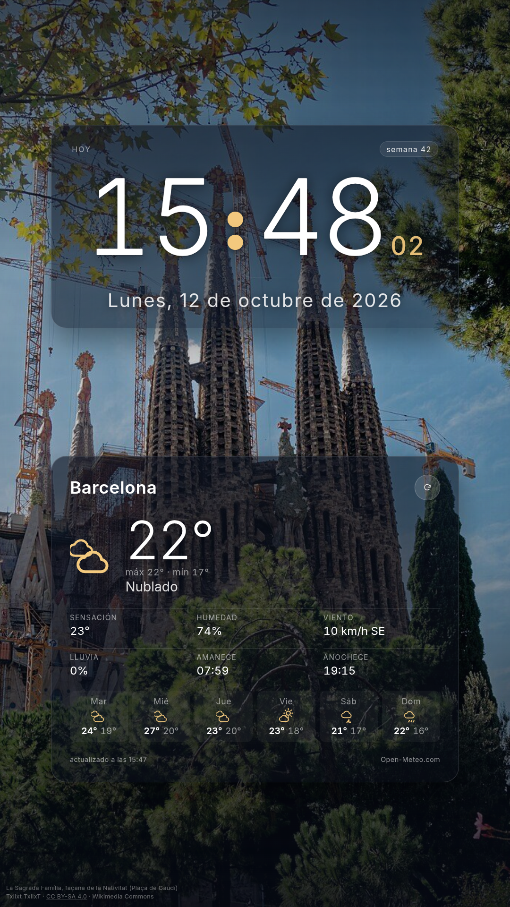
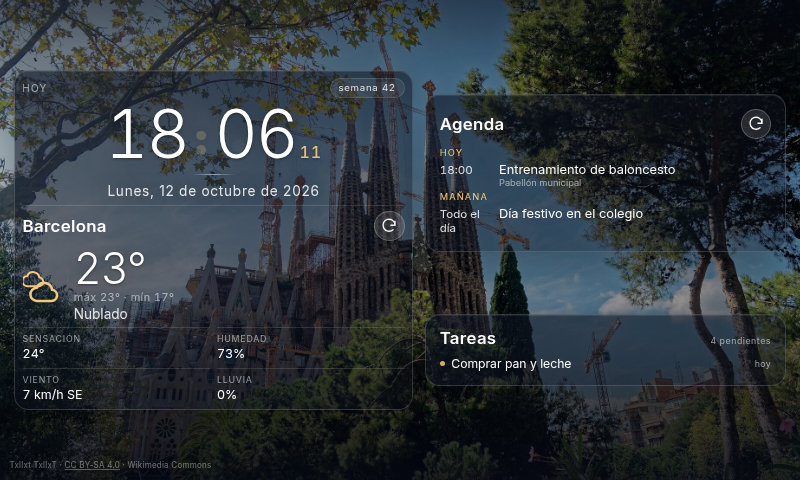
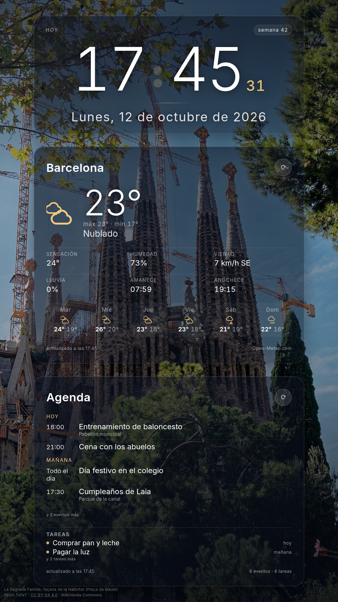

# Family Dashboard

Panel familiar para una **Raspberry Pi 4 con pantalla táctil**, servido en local y
mostrado a pantalla completa en **Chromium en modo kiosco**.

Stack: **TypeScript + React + Vite** en el cliente, **Node.js + Express + SQLite**
(`node:sqlite`, sin dependencias nativas) en el servidor.



---

## Qué hay hecho

### Fase 1 — pantalla de inicio ✅

- Fondo a pantalla completa con una foto de **La Sagrada Família** (façana de la
  Nativitat, Plaça de Gaudí).
- **Hora** en grande (24 h, cifras tabulares, dos puntos que parpadean cada segundo)
  y **fecha larga en español** (`Lunes, 12 de octubre de 2026`).
- El reloj se reajusta al segundo exacto del sistema en cada tick
  (`src/hooks/useNow.ts`), para estar semanas encendido sin desviarse.
- **Dos formatos con el mismo código**: vertical (la pantalla de 27" de la Pi,
  1080×1920) y apaisado. Con `clamp()`/`vmin` y una media query de orientación: en
  vertical el reloj sube arriba y la tarjeta del tiempo se queda debajo, con letra
  más grande y con amanecer/anochecer y 6 días de previsión que en apaisado no caben.
- Modo kiosco (`?kiosk=1`): oculta el cursor y desactiva la selección de texto.

### Fase 2 — backend y dos widgets ✅

La pantalla está partida en **dos widgets**: el reloj a la izquierda y, a la
derecha, una tarjeta con **el tiempo de tu ciudad** (en los ejemplos, Barcelona;
la localidad real se configura con `PUT /api/settings`).

- **Los dos son tarjetas de cristal del mismo ancho**: mismo fondo translúcido,
  mismo borde y mismo redondeo, para que el panel se lea como una sola cosa. En
  vertical van apiladas (reloj arriba, tiempo debajo); en apaisado, lado a lado.
  La tarjeta del reloj lleva su propia cabecera (etiqueta `Hoy` y la pastilla con
  el número de semana ISO, que luego usará el menú semanal).
- **Servidor Express** (`server/`) que sirve la API *y* el build del cliente en un
  solo proceso (puerto 4173).
- **SQLite** para cachear la meteo y guardar ajustes (qué localidad, etc.).
  `node:sqlite` viene dentro de Node 22+, así que **no hay módulos nativos que
  compilar** en la Raspberry.
- **Meteo de Open-Meteo** (sin API key): temperatura, sensación, humedad, viento
  (con dirección), probabilidad de lluvia, máx/mín y previsión de 5 días, con
  iconos SVG propios según el código WMO.
- Si Open-Meteo no responde, el backend **sirve la última lectura cacheada** y el
  widget lo indica; si el backend entero cae, el reloj sigue funcionando igual.



### Fase 3 — agenda: Google Calendar y tareas ✅

Tercer widget, debajo del tiempo: **próximos eventos agrupados por día** (`Hoy`,
`Mañana`, `jue 16`…) y **tareas pendientes** con su vencimiento (`hoy`, `mañana`,
`vencida`). Si hay más de los que caben en la pantalla, lo dice (`y 2 eventos más`)
en vez de cortarlos en silencio.

- **OAuth 2.0 a mano** (`server/src/google/auth.ts`), sin la librería `googleapis`:
  son cuatro llamadas HTTP. Modelo de *app instalada*, con redirect a loopback.
- El **refresh_token vive en SQLite** (tabla `google_account`), así que el panel
  funciona meses sin que nadie vuelva a iniciar sesión: el backend refresca el
  access_token solo, cuando caduca.
- Permisos mínimos: `calendar.readonly`, `tasks.readonly` y `userinfo.email`.
- Si falta configurar o autorizar, el widget **lo dice en pantalla** en vez de
  quedarse en blanco (`reason` en la respuesta), y el reloj y el tiempo siguen
  funcionando.
- Para trabajar en la interfaz sin credenciales hay datos simulados:
  `DASH_MOCK=1 DASH_DB=/tmp/ejemplo.sqlite npm run dev:api`. Nunca se activa solo,
  y las respuestas lo marcan con `meta.source: "mock"`. Usa una **base de datos
  aparte** (`DASH_DB`): si no, los datos de ejemplo se quedan en la caché del panel
  de verdad y los sigues viendo cuando apagues el mock.



**Conectar tu cuenta** (una sola vez, ver más abajo el paso a paso).

---

## Estructura

```
Family_dash/
├── index.html                  # <title>, viewport, tema oscuro, notranslate
├── public/
│   └── sagrada-familia.jpg     # foto de fondo (1920×1280, CC BY-SA 4.0)
├── scripts/
│   ├── kiosk.sh                # lanza Chromium a pantalla completa
│   ├── restart-kiosk.sh        # reinicia el kiosco (tras desplegar, por ejemplo)
│   ├── google-auth.mjs         # consentimiento de Google (loopback)
│   └── google-token-copy.mjs   # pasar la autorización de un equipo a otro
├── server/
│   ├── tsconfig.json
│   └── src/
│       ├── index.ts            # app Express: API + estáticos + apagado limpio
│       ├── config.ts           # puerto, ruta de la BD, TTLs, localidad de ejemplo
│       ├── db.ts               # apertura de SQLite y migraciones
│       ├── cache.ts            # caché con TTL y respaldo "stale"
│       ├── settings.ts         # ajustes persistidos (localidad) y su validación
│       ├── routes/
│       │   ├── weather.ts      # GET /api/weather
│       │   ├── settings.ts     # GET/PUT /api/settings
│       │   ├── google.ts       # estado y flujo de consentimiento (solo localhost)
│       │   └── agenda.ts       # GET /api/calendar y /api/tasks
│       ├── google/
│       │   ├── auth.ts         # OAuth, token en SQLite y refresco automático
│       │   ├── api.ts          # GET autenticado contra las APIs de Google
│       │   ├── calendar.ts     # eventos normalizados
│       │   ├── tasks.ts        # tareas pendientes de todas las listas
│       │   └── mock.ts         # datos simulados (solo con DASH_MOCK=1)
│       └── weather/
│           ├── openMeteo.ts    # cliente de Open-Meteo y normalización
│           └── wmo.ts          # códigos WMO → texto en español + icono
└── src/
    ├── App.tsx                 # compone los tres widgets
    ├── App.css                 # layout + tarjetas del tiempo y la agenda
    ├── index.css               # reset + variables de tema
    ├── config.ts               # idioma, cadencias de refresco, créditos
    ├── components/
    │   ├── Background.tsx      # foto + degradados para legibilidad
    │   ├── ClockWidget.tsx     # widget 1: hora y fecha
    │   ├── WeatherWidget.tsx   # widget 2: el tiempo
    │   ├── AgendaWidget.tsx    # widget 3: eventos y tareas
    │   ├── WeatherIcon.tsx     # iconos SVG por código WMO
    │   └── PhotoCredit.tsx     # crédito CC BY-SA
    ├── hooks/
    │   ├── useNow.ts           # reloj alineado al segundo
    │   ├── useWeather.ts       # pide /api/weather y se refresca sola
    │   └── useAgenda.ts        # pide /api/calendar y /api/tasks
    └── lib/
        ├── api.ts              # cliente HTTP tipado
        ├── time.ts             # formato de fecha/hora + etiquetas de la agenda
        └── types.ts            # tipos de la API
```

---

## API

| Método | Ruta | Qué hace |
|--------|------|----------|
| GET | `/api/health` | Estado, versión de Node, ruta de la BD y nº de entradas en caché |
| GET | `/api/weather` | Tiempo actual + previsión. `?refresh=1` fuerza ir a la red |
| GET | `/api/settings` | Localidad configurada (y la de por defecto) |
| PUT | `/api/settings` | Cambia la localidad: `{"place":{"name":"Barcelona","latitude":41.3874,"longitude":2.1686,"timezone":"Europe/Madrid"}}` |
| GET | `/api/calendar` | Próximos eventos agrupables por día (`?days=7`, `?refresh=1`) |
| GET | `/api/tasks` | Tareas pendientes de todas las listas, por fecha |
| GET | `/api/google/status` | Si falta configurar o autorizar, y con qué cuenta |
| POST | `/api/google/app` | Guarda `client_id` y `client_secret` — **solo desde localhost** |
| GET | `/api/google/auth-url` | Devuelve la URL de consentimiento — **solo desde localhost** |
| POST | `/api/google/exchange` | Canjea el código y guarda el refresh_token — **solo desde localhost** |
| POST | `/api/google/disconnect` | Revoca el acceso y borra los tokens — **solo desde localhost** |

Los cuatro últimos manejan secretos, así que solo aceptan peticiones desde la
propia máquina (127.0.0.1/::1): desde la LAN responden `403 local_only`.

La respuesta de `/api/weather` incluye un bloque `meta` que dice si los datos
vienen de la red o de SQLite (`cached`), si son la última lectura buena porque la
red falló (`stale`) y cuándo se obtuvieron (`fetchedAt`). Ese `meta` es lo que usa
la tarjeta para escribir *"actualizado a las 14:48"* o *"sin conexión"*.

### Base de datos

`data/dashboard.sqlite` (WAL), con migraciones versionadas al arrancar:

- `cache(key, payload, source, fetched_at, expires_at)` — respuestas de APIs con
  su caducidad. TTL: meteo **10 minutos** (`WEATHER_TTL_MS`), calendario y tareas
  **5 minutos** (`CALENDAR_TTL_MS`, `TASKS_TTL_MS`).
- `settings(key, value, updated_at)` — por ahora, la localidad del tiempo.
- `google_app(id=1, client_id, client_secret, updated_at)` — credenciales de la
  app de Google Cloud (o mejor por entorno: `GOOGLE_CLIENT_ID`/`GOOGLE_CLIENT_SECRET`).
- `google_account(id=1, email, refresh_token, access_token, access_expires_at, scope, …)`
  — la cuenta autorizada. El refresh_token es lo que mantiene el panel conectado.
- `schema_migrations(version, name, applied_at)`.

Cambiar la ciudad sin tocar código:

```bash
curl -X PUT -H 'content-type: application/json' \
  -d '{"place":{"name":"Barcelona","country":"ES","latitude":41.3874,"longitude":2.1686,"timezone":"Europe/Madrid"}}' \
  http://localhost:4173/api/settings
```

---

## Uso

```bash
npm install          # dependencias (cliente + servidor)
npm run build        # tipos + build del cliente (dist/) + compila el servidor
npm run start        # arranca Express: API + panel en http://localhost:4173

npm run dev          # solo el cliente (Vite, :5173) con proxy /api → :4173
npm run dev:api      # solo el backend, recompilando y reiniciando al guardar
npm run lint         # oxlint
```

En desarrollo hacen falta las dos cosas: `npm run dev:api` en una terminal y
`npm run dev` en otra.

---

## Cómo está montado en la Raspberry Pi

Hardware/OS de la Pi de casa: Raspberry Pi OS sobre **Debian 13 (trixie)**, aarch64,
sesión **Wayland con labwc** (`rpd-labwc`), autologin activado, **pantalla de 27"
puesta en vertical** (1080×1920, HDMI-A-1, transform 90) con panel táctil ILITEK.

| Pieza | Dónde | Qué hace |
|-------|-------|----------|
| Node 22 LTS | `/usr/local` (tarball oficial arm64) | runtime; el `nodejs` de Debian trixie es 20.x, ya EOL |
| `~/Desktop/Family_dash` | copia del proyecto + `npm ci` + build | el panel |
| `~/.config/systemd/user/family-dash.service` | servicio de usuario | sirve API + panel en el 4173 y se reinicia si falla |
| `loginctl enable-linger <usuario>` | — | el servicio arranca al encender, sin login |
| `~/.config/autostart/family-dash.desktop` | autostart XDG | lanza `scripts/kiosk.sh` al entrar en el escritorio |
| `~/.config/kanshi/config` | perfil de pantalla | deja la salida en vertical en cada arranque (lo lee `kanshi`, que labwc lanza solo) |

### Girar la pantalla (vertical)

El monitor está montado en vertical, así que la salida se rota 90°. **Persistente**
(el perfil lo aplica `kanshi` en cada arranque):

```ini
# ~/.config/kanshi/config
profile portrait-27 {
	output HDMI-A-1 enable mode 1920x1080@60.000 position 0,0 scale 1.000000 transform 90
}
```

Y para aplicarlo sin reiniciar, o para probar el otro sentido:

```bash
wlr-randr --output HDMI-A-1 --transform 90     # girado a un lado
wlr-randr --output HDMI-A-1 --transform 270    # girado al otro (si se ve boca abajo)
wlr-randr --output HDMI-A-1 --transform normal # volver a apaisado
pkill -HUP -x kanshi                           # recargar el perfil guardado
```

Ojo: **la captura de pantalla no sirve para saber si está del derecho**. `grim`
guarda la imagen ya en coordenadas lógicas, así que un 90 y un 270 dan el mismo
PNG; hay que mirar la pantalla física. Si la imagen se ve boca abajo, cambia 90
por 270 (también en el perfil de kanshi).

La pantalla táctil sigue el giro automáticamente porque `~/.config/labwc/rc.xml`
la mapea a la salida (`<touch deviceName="ILITEK Multi-Touch-V5000 (USB 1-1.1)"
mapToOutput="HDMI-A-1" mouseEmulation="yes"/>`). Aun así, conviene probar tocando
el botón de refrescar de la tarjeta.

### Servicio y arranque automático

`~/.config/systemd/user/family-dash.service` — sirve API + panel y se reinicia si
falla:

```ini
[Unit]
Description=Family Dashboard (servidor local del panel)
After=network-online.target
Wants=network-online.target

[Service]
Type=simple
WorkingDirectory=/home/<usuario>/Desktop/Family_dash
Environment=PATH=/usr/local/bin:/usr/bin:/bin
ExecStart=/usr/local/bin/npm run start
Restart=always
RestartSec=5

[Install]
WantedBy=default.target
```

```bash
sudo loginctl enable-linger <usuario>            # arranca sin login
systemctl --user daemon-reload
systemctl --user enable --now family-dash.service
journalctl --user -u family-dash.service -f      # logs
```

`~/.config/autostart/family-dash.desktop` — lo procesa `lxsession-xdg-autostart`,
que labwc lanza desde `/etc/xdg/labwc/autostart`:

```ini
[Desktop Entry]
Type=Application
Name=Family Dashboard
Exec=/home/<usuario>/Desktop/Family_dash/scripts/kiosk.sh
Icon=chromium
Terminal=false
X-GNOME-Autostart-enabled=true
```

### Conectar la cuenta de Google (una sola vez)

1. En [Google Cloud Console](https://console.cloud.google.com/) crea un proyecto
   (o usa uno que ya tengas).
2. En *APIs y servicios → Biblioteca*, habilita **Google Calendar API** y
   **Google Tasks API**.
3. En *APIs y servicios → Pantalla de consentimiento OAuth*: tipo **Externo**,
   ponle un nombre y **añádete como usuario de prueba** (tu propia cuenta).
4. En *Credenciales → Crear credenciales → ID de cliente de OAuth*, tipo de
   aplicación **Aplicación de escritorio**. Copia el *client ID* y el *client secret*.
5. Dale las credenciales al backend y conecta la cuenta:

```bash
curl -X POST http://127.0.0.1:4173/api/google/app \
  -H 'content-type: application/json' \
  -d '{"client_id":"…apps.googleusercontent.com","client_secret":"…"}'

node scripts/google-auth.mjs      # abre el navegador y recoge el código solo
```

6. Si el consentimiento lo haces en un equipo con teclado (más cómodo que el de la
   pantalla táctil), copia la autorización a la Pi:

```bash
node scripts/google-token-copy.mjs export > /tmp/google-auth.json
scp /tmp/google-auth.json <usuario>@<ip-de-la-pi>:/tmp/

# en la Pi
node scripts/google-token-copy.mjs import /tmp/google-auth.json
systemctl --user restart family-dash.service
rm /tmp/google-auth.json          # contiene el refresh_token: no lo dejes por ahí
```

Comprobación: `curl -s http://127.0.0.1:4173/api/google/status` debe decir
`connected: true` con tu email, y `/api/calendar` devolver eventos.

> **Cuidado con el modo *Prueba*.** Mientras la pantalla de consentimiento esté en
> *Testing*, Google caduca los refresh_token **a los 7 días** y habría que repetir
> el paso 5 cada semana. Para un panel que vive en la pared, publica la app
> (*Publicar app* → en producción). Para uso propio no hace falta verificación:
> verás el aviso de "app no verificada" y podrás continuar.

### Actualizar el panel

`node_modules` **no** se copia nunca: los binarios nativos del equipo de
desarrollo son x86_64 y no valen en arm64.

```bash
# en el equipo de desarrollo
npm run build
cd ~/Desktop && tar czf /tmp/family-dash.tgz \
  --exclude='Family_dash/node_modules' --exclude='Family_dash/.git' --exclude='Family_dash/data' \
  Family_dash
scp /tmp/family-dash.tgz <usuario>@<ip-de-la-pi>:/tmp/

# en la Pi
cd ~/Desktop && tar xzf /tmp/family-dash.tgz && cd Family_dash
npm ci && npm run build
systemctl --user restart family-dash.service     # recarga el backend
./scripts/restart-kiosk.sh                       # recarga la pantalla
```

Para comprobar que la copia es fiel: comparar `sha256sum` de los dos árboles
(ignorando `node_modules` y `data`).

### Kiosco

```bash
scripts/kiosk.sh            # arranca Chromium a pantalla completa
scripts/restart-kiosk.sh    # lo reinicia (mata, limpia el perfil y relanza)
```

### Detalles que cuestan sangre (Wayland + kiosco)

- **`--ozone-platform=wayland`.** En la sesión labwc no hay servidor X: sin este
  flag Chromium intenta X11 y muere con *"Missing X server or $DISPLAY"*.
- **`--password-store=basic`.** Con autologin el llavero está cerrado, así que
  Chromium pide desbloquearlo con un diálogo modal que tapa el kiosco.
- **`<meta name="google" content="notranslate">`** en el HTML: evita la burbuja
  "traducir esta página" (`--disable-features=Translate` ya no basta en Chromium 154).
- **Reiniciar el kiosco no es matar y relanzar a lo bruto.** Si Chromium sigue
  vivo con el mismo `--user-data-dir`, el nuevo proceso se limita a pasarle la URL
  al que ya está: seguirías viendo la versión antigua y sin ningún error.
  `restart-kiosk.sh` mata con `-9` y borra el perfil antes de relanzar.
- **El HTML se sirve con `Cache-Control: no-store`** (los assets llevan hash en el
  nombre y sí se cachean para siempre). Si no, el navegador reutiliza el HTML viejo.
- **Pantalla siempre encendida:** `xset` es de X11; en Wayland el script usa
  `systemd-inhibit --what=idle --mode=block` (best-effort: si polkit no lo permite,
  arranca igual sin inhibidor).
- **La pantalla táctil** está mapeada en `~/.config/labwc/rc.xml`
  (`<touch deviceName="ILITEK Multi-Touch-V5000 (USB 1-1.1)" mapToOutput="HDMI-A-1" mouseEmulation="yes"/>`).

### Comprobar / depurar en la Pi

```bash
curl -s http://127.0.0.1:4173/api/health                 # estado del backend
journalctl --user -u family-dash.service -f              # logs del servidor
ps -o pid,lstart,cmd -C chromium | grep kiosk            # ¿kiosco vivo y de cuándo?
XDG_RUNTIME_DIR=/run/user/1000 WAYLAND_DISPLAY=wayland-0 \
  grim /tmp/pantalla.png                                 # captura de la pantalla
curl -sI http://127.0.0.1:4173/ | grep -i cache-control  # no-store en el HTML
```

---

## Fases siguientes

| Fase | Contenido | Estado |
|------|-----------|--------|
| 1 | Pantalla de inicio: hora, fecha y foto | ✅ |
| 2 | Backend Node + Express + SQLite y dos widgets (reloj / tiempo) | ✅ |
| 3 | Agenda: Google Calendar y tareas (widget + OAuth propio) | ✅ código hecho; falta conectar tu cuenta |
| 4 | Noticias RSS | pendiente |
| 5 | Menú semanal desde el Synology Drive | pendiente |
| 6 | Navegación táctil entre pantallas | pendiente |

Notas de arquitectura para lo que viene:

- Los tokens de Google no deben acabar en el bundle del cliente: el navegador
  habla solo con `/api/*` y es Node quien llama a Google. Los tokens van a la
  tabla `settings` (o a una propia) con permisos `600` sobre el fichero SQLite.
- Cualquier API nueva debería pasar por la caché de `cache.ts` con su TTL, para
  que el panel siga enseñando datos cuando se cae internet.

---

## Licencia

[MIT](LICENSE) © 2026 kamalimiquel.

## Créditos

Foto: *La Sagrada Família, façana de la Nativitat (Plaça de Gaudí)* de
**Txllxt TxllxT**, [CC BY-SA 4.0](https://creativecommons.org/licenses/by-sa/4.0/),
vía [Wikimedia Commons](https://commons.wikimedia.org/wiki/File:Barcelona_-_Pla%C3%A7a_de_Gaud%C3%AD_-_View_SW_on_La_Sagrada_Fam%C3%ADlia_-_Nativity_fa%C3%A7ade_I.jpg).
El crédito aparece discretamente en la esquina inferior izquierda, como exige la
licencia. Meteo: [Open-Meteo](https://open-meteo.com) (uso no comercial, sin API key).
