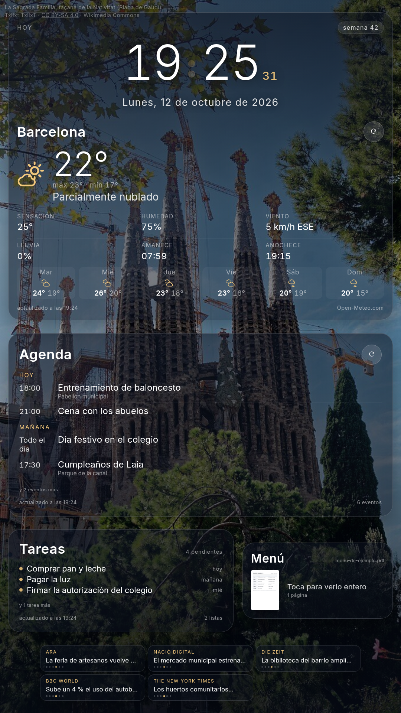
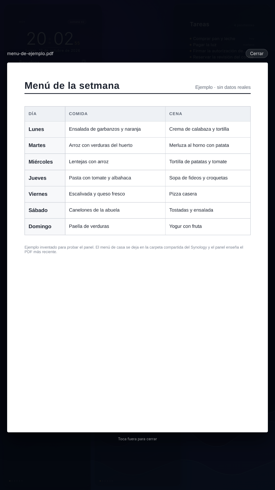

# Family Dashboard

Panel familiar para una **Raspberry Pi 4 con pantalla táctil**, servido en local y
mostrado a pantalla completa en **Chromium en modo kiosco**.

Stack: **TypeScript + React + Vite** en el cliente, **Node.js + Express + SQLite**
(`node:sqlite`, sin dependencias nativas) en el servidor. Cinco bloques — **hora y
tiempo**, **tareas**, **agenda**, **menú** de la carpeta compartida y **titulares**
de prensa— colocados con **medidas en centímetros** sobre un **vídeo de fondo**.



---

## Qué hay hecho

### Fase 1 — pantalla de inicio ✅

- Fondo a pantalla completa con una foto de **La Sagrada Família** (façana de la
  Nativitat, Plaça de Gaudí). *(En la fase 7 el fondo pasó a ser animado, sin foto;
  de ahí que ya no haya crédito que enseñar.)*
- **Hora** en grande (24 h, cifras tabulares, dos puntos que parpadean cada segundo)
  y **fecha larga en español** (`Lunes, 12 de octubre de 2026`).
- El reloj se reajusta al segundo exacto del sistema en cada tick
  (`src/hooks/useNow.ts`), para estar semanas encendido sin desviarse.
- **Dos formatos con el mismo código**: vertical (la pantalla de 27" de la Pi,
  1080×1920) y apaisado. Con `clamp()`/`vmin` y una media query de orientación: en
  vertical las tarjetas se apilan con letra más grande, y es donde caben el
  amanecer/anochecer y 6 días de previsión que en apaisado no entran.
- Modo kiosco (`?kiosk=1`): oculta el cursor y desactiva la selección de texto.

### Fase 2 — backend y el tiempo ✅

Una tarjeta con **el tiempo de tu ciudad** (en los ejemplos, Barcelona; la localidad
real se configura con `PUT /api/settings`).

- **Todas las tarjetas son de cristal y del mismo ancho**: mismo fondo translúcido,
  mismo borde y mismo redondeo, para que el panel se lea como una sola cosa. La
  cabecera de la primera lleva la etiqueta `Hoy` y la pastilla con el número de
  semana ISO (que luego usará el menú semanal).
- **Servidor Express** (`server/`) que sirve la API *y* el build del cliente en un
  solo proceso (puerto 4173).
- **SQLite** para cachear la meteo y guardar ajustes (qué localidad, etc.).
  `node:sqlite` viene dentro de Node 22+, así que **no hay módulos nativos que
  compilar** en la Raspberry.
- **Meteo de Open-Meteo** (sin API key): temperatura, sensación, humedad, viento
  (con dirección), probabilidad de lluvia, máx/mín y previsión de 5 días, con
  iconos SVG propios según el código WMO.
- Si Open-Meteo no responde, el backend **sirve la última lectura cacheada** y el
  widget lo indica; si el backend entero cae, el reloj sigue funcionando igual.


### Fase 3 — Google Calendar y tareas ✅

Dos tarjetas más, **una para el calendario y otra para las tareas**: la **Agenda**
con los próximos eventos agrupados por día (`Hoy`, `Mañana`, `jue 16`…) y la de
**Tareas** con las pendientes y su vencimiento (`hoy`, `mañana`, y `vencida` en
rojo cuando la fecha ya pasó). Si hay más de los que caben en la pantalla lo dicen
(`y 2 eventos más`, `y 28 tareas más`) en vez de cortarlos en silencio, y el pie de
cada tarjeta lleva su propio recuento (`6 eventos`, `31 pendientes · 4 listas`).

- **OAuth 2.0 a mano** (`server/src/google/auth.ts`), sin la librería `googleapis`:
  son cuatro llamadas HTTP. Modelo de *app instalada*, con redirect a loopback.
- El **refresh_token vive en SQLite** (tabla `google_account`), así que el panel
  funciona meses sin que nadie vuelva a iniciar sesión: el backend refresca el
  access_token solo, cuando caduca.
- Permisos mínimos: `calendar.readonly`, `tasks.readonly` y `userinfo.email`.
- Si falta configurar o autorizar, **las dos tarjetas lo dicen en pantalla** en vez
  de quedarse en blanco (`reason` en la respuesta), y el reloj y el tiempo siguen
  funcionando.
- Para trabajar en la interfaz sin credenciales hay datos simulados:
  `DASH_MOCK=1 DASH_DB=/tmp/ejemplo.sqlite npm run dev:api`. Nunca se activa solo,
  y las respuestas lo marcan con `meta.source: "mock"`. Usa una **base de datos
  aparte** (`DASH_DB`): si no, los datos de ejemplo se quedan en la caché del panel
  de verdad y los sigues viendo cuando apagues el mock.

**Conectar tu cuenta** (una sola vez, ver más abajo el paso a paso).

### Fase 4 — la hora y el tiempo, en una sola tarjeta ✅

Dejaron de ser dos tarjetas: ahora comparten una —cabecera (`Hoy` + semana ISO), la
hora en grande, la fecha y, debajo de una línea, el tiempo de la localidad con su
previsión— para que el panel se lea de un vistazo y quede sitio para la agenda y las
tareas. Los dos siguen siendo componentes sueltos (`ClockWidget`, `WeatherWidget`)
que **no pintan tarjeta**: el cristal lo pone `NowWidget`, así que se pueden
recomponer sin tocar sus estilos.

Con tres tarjetas el panel se reparte distinto: en vertical se apilan (hora y
tiempo, agenda, tareas) y en apaisado la primera ocupa la columna izquierda entera
mientras agenda y tareas se apilan a la derecha. En la pantalla de 7" (800×480) el
reloj se encoge y se cae la previsión de días, o no cabe.

### Fase 5 — franja de titulares de prensa ✅

Abajo del todo, **una tarjeta por medio**: cada una enseña un titular cada vez y va
rotando los suyos (10 s, con arranque escalonado para que no cambien todas a la
vez). Los puntitos dicen por cuál va, de los ocho que guarda de cada feed.

- **RSS y Atom con un parser propio** (`server/src/news/rss.ts`): titulares, enlaces
  y fechas, con CDATA, entidades y los dos formatos. Sin dependencias.
- **Las fuentes se configuran** con `PUT /api/settings` y viven en la base de datos
  del dispositivo, no en el código: el repositorio no lleva los medios de ninguna
  casa, y cambiar de fuentes no es tocar código.
- **Una caché por fuente** (15 minutos): si un medio se cae, esa tarjeta lo dice en
  rojo y las otras cuatro siguen con sus titulares; si ya había titulares guardados,
  enseña los últimos buenos en vez de vaciarse.
- Los titulares **no son enlaces** a propósito: en el kiosco, un toque dejaría el
  panel metido en una noticia y ya no volvería solo.
- Si hay menos fuentes de las que caben, la franja se adapta (con cuatro, dos
  columnas; con dos o menos, una); y si no hay alto suficiente (la pantalla de 7"),
  se quita entera antes que enseñarla a medias.

### Fase 6 — el menú en PDF, desde la carpeta compartida ✅

Entre las tareas y los titulares, una tarjeta con **el PDF que se deja en una
carpeta compartida** del NAS (el menú de la semana). Enseña la primera página en
pequeño y, **al tocarla, se abre a pantalla completa** encima del panel.



- **La carpeta se monta por SMB** en la Pi (paso a paso en el despliegue, más abajo)
  y la aplicación solo lee de una ruta local.
- Se enseña **el PDF más reciente** de la carpeta: para cambiar el menú basta con
  dejar el fichero nuevo ahí, sin tocar nada más.
- El backend lo **rasteriza con `pdftoppm`** (poppler, que ya viene en Raspberry Pi
  OS) a 1500 px de ancho y guarda las páginas en `data/pdf/<versión>/`. Si el
  fichero no ha cambiado no se vuelve a convertir, y si cambia, la versión en la
  URL impide que el navegador enseñe la página vieja.
- Como todo lo demás, cuando algo falla **lo dice en pantalla** en vez de quedarse
  en blanco: carpeta sin montar, carpeta vacía, PDF ilegible o sin páginas.
- El visor se abre **encima del panel, sin salir de la aplicación** (y los
  titulares no son enlaces, por lo mismo): en un kiosco, irse a un visor aparte es
  quedarse atrapado en él.

### Fase 7 — fondo animado y reparto en centímetros ✅

Fuera la foto: el fondo es ahora un **degradado violeta y azul con manchas que se
mueven despacio y unas olas en la esquina inferior derecha**, todo con CSS y SVG
(solo `transform` y opacidad, que es lo que la GPU de la Pi mueve sin sudar; nada de
filtros animados). Sin foto no hay crédito que enseñar, y desaparece el
`PhotoCredit`.

Y el reparto de la pantalla está pedido en **centímetros**, no en píxeles: la
pantalla de la Pi es de 27" con 1080×1920, o sea 81,6 px/pulgada → **32,12 px por
centímetro** (`--cm` en `App.css`).

| Zona | Medida |
|------|--------|
| Arriba izquierda | hora y tiempo · **12 × 12 cm** |
| Arriba derecha | tareas · **12 × 12 cm** |
| Debajo | agenda · ancho completo, la altura que pida su contenido |
| Debajo | menú (el PDF) · ancho de la agenda × **10 cm** |
| Lo que queda | titulares de prensa |

Las dos tarjetas cuadradas miden su contenido con **unidades de contenedor**
(`cqw`/`cqh`): el reloj se ve igual de grande a cualquier resolución, porque no
depende de la pantalla sino de la tarjeta. A 12 cm de alto dentro solo cabía lo
esencial (la hora, la fecha y el tiempo de ahora); **en la fase 8 la tarjeta pasó a ser
apaisada (19 × 12 cm) y volvieron la previsión y el detalle**. Las medidas de la tabla
también se revisaron en la fase 8.

En apaisado las medidas físicas no caben (12 + 22 + 10 cm se comen los 1080 de alto),
así que la unidad se encoge y las tarjetas vuelven a medir lo que piden sus contenidos.

### Fase 8 — fondo de vídeo y medidas nuevas ✅

El fondo es ahora un **vídeo**: una animación de seda violeta y azul que vive en
`public/fondo.mp4` — 720×1280, 24 fotogramas por segundo, sin audio, 2 MB y 30 s en
bucle. Va recortado a lo ancho (`object-fit: cover`), así que en la pantalla vertical
se ve la franja central del original, que es justo por donde pasa la transición de
color.

Tres cosas del vídeo que conviene saber:

- **El degradado de la fase 7 se queda detrás**, con sus manchas y sus olas, como red
  de seguridad: si el vídeo no arranca se ve un fondo decente, no un hueco negro. El
  póster (`fondo.jpg`) tapa el hueco mientras carga.
- **Un velo por encima** (`backdrop__scrim`) le baja el brillo; sin él, las zonas
  claras del vídeo se comen el texto de las tarjetas.
- Si el sistema pide **movimiento reducido**, el vídeo ni se pone: quedan el degradado
  y las olas.

Y cuesta CPU, que es lo primero que hay que mirar en una Pi: con el vídeo puesto, la
máquina se queda en torno al **40 % ocupada** (58 % en reposo, medido con `top`,
1080p24 decodificado por software). El panel va fluido, pero queda anotado: si algún
día va justa, lo primero que hay que bajar es el tamaño del vídeo.

El reparto cambia de medidas:

| Zona | Fase 7 | Fase 8 (final) |
|------|--------|----------------|
| Hora y tiempo | 12 × 12 cm | **19 cm de ancho × 12 de alto** |
| Tareas | 12 × 12 cm | 12 × 12 cm (pegada arriba) |
| Agenda | ancho completo, alto del contenido | ancho completo, **22 cm** |
| Menú (el PDF) | ancho de la agenda × 10 cm | igual |
| Titulares | lo que queda | lo que queda (unos 430 px, **dos columnas**) |

La tarjeta de la hora y el tiempo acabó **apaisada** (19 × 12), no alta: el reloj va a la
izquierda y el tiempo a la derecha. Al ser ancha, el tiempo vuelve a enseñar lo que a
12 cm no cabía —el detalle (sensación, humedad, viento, lluvia) y la previsión de los
próximos días—, con **cuatro días** en la franja: siete en esa columna se pisaban unos
a otros. Y como las dos tarjetas de arriba miden 12 cm de alto, la fila queda a ras y el
hueco que antes sobraba entre ellas (278 px) se queda en 54. La agenda, al ser tan alta,
reparte sus días por todo el alto para no quedarse medio vacía en una semana tranquila.

### Fase 9 — el mapa de dónde está la familia ✅ (con letra pequeña)

La tarjeta del mapa va arriba a la derecha (13,2 × 12 cm) y las tareas pasan a una columna
**en paralelo a la agenda** (12 × 22 cm), donde caben diez de golpe en vez de cuatro.

El mapa se pinta con el **embed de Google sin clave de API**
(`maps.google.com/maps?q=…&output=embed`): cero configuración y cero facturas… pero solo sabe
enseñar **un punto por mapa**, así que la tarjeta va rotando entre las personas cada 45 s, con su
nombre, su dirección y de cuándo es la posición. El iframe lleva `pointer-events: none`: el embed
trae enlaces a Google Maps y, en un kiosco, un dedo te dejaría fuera del panel.

**De dónde salen las ubicaciones**: de reutilizar la sesión del navegador. Google **no tiene API**
para leer las ubicaciones compartidas de otros usuarios (es una petición abierta desde hace años);
lo único que funciona es pedírselas a su servicio interno con las cookies de una sesión iniciada,
que es lo que hacen Home Assistant y [`locationsharinglib`](https://github.com/costastf/locationsharinglib)
—de ahí salen la petición (`GET /maps/rpc/locationsharing/read`) y el mapeo de campos de
`server/src/locations/sharing.ts`—. Las ubicaciones de **Family Link son, por debajo, las mismas de
Google Maps** (Google lo documenta así al explicar la supervisión parental), así que esta vía las
cubre todas.

Ponerlo en marcha (una vez por máquina):

```bash
# 1. Exportar las cookies del navegador donde tengas la sesión de Google.
#    El script se las pide al propio Chromium por CDP (ya descifradas) y NUNCA
#    imprime sus valores: las deja en ~/.config/family-dash/ con permisos 600.
python3 export-cookies.py
# 2. Copiarlas al dispositivo, al lado de su base de datos, con permisos 600 del
#    usuario del panel (solo se lee; no hace falta nada más).
install -m 600 google-cookies.txt <ruta-del-proyecto>/data/google-cookies.txt
```

Se puede cambiar de sitio con `LOCATIONS_COOKIES=/ruta/al/fichero`.

**La letra pequeña, que conviene no olvidar**: ese fichero da acceso a la cuenta de Google (de ahí
los 600, que viva en `data/` —que no viaja en el despliegue ni al repositorio— y que no se suba a
ningún sitio), y **caduca**. Cuando caduque, la tarjeta lo dice tal cual —*«La sesión de Google
caducó: hay que renovar las cookies»*— y se arregla repitiendo los dos pasos. Y si algún día Google
cambia su servicio interno, esto dejará de funcionar: es lo que hay cuando no existe API.

---

## Estructura

```
Family_dash/
├── index.html                  # <title>, viewport, tema oscuro, notranslate
├── public/
│   ├── favicon.svg             # icono
│   ├── icons.svg               # juego de iconos SVG
│   ├── fondo.mp4               # vídeo de fondo (720×1280, mudo, en bucle)
│   └── fondo.jpg               # póster del vídeo (mientras carga)
├── scripts/
│   ├── kiosk.sh                # lanza Chromium a pantalla completa
│   ├── restart-kiosk.sh        # reinicia el kiosco (tras desplegar, por ejemplo)
│   ├── google-auth.mjs         # consentimiento de Google (loopback)
│   ├── google-token-copy.mjs   # pasar la autorización de un equipo a otro
│   ├── measure-panel.py        # mide las tarjetas por CDP y prueba un toque real
│   └── export-cookies.py       # saca las cookies de Google del navegador (para el mapa)
├── server/
│   ├── tsconfig.json
│   └── src/
│       ├── index.ts            # app Express: API + estáticos + apagado limpio
│       ├── config.ts           # puerto, ruta de la BD, TTLs, localidad de ejemplo
│       ├── db.ts               # apertura de SQLite y migraciones
│       ├── cache.ts            # caché con TTL y respaldo "stale"
│       ├── settings.ts         # ajustes persistidos (localidad) y su validación
│       ├── routes/
│       │   ├── weather.ts      # GET /api/weather
│       │   ├── settings.ts     # GET/PUT /api/settings (localidad y fuentes)
│       │   ├── google.ts       # estado y flujo de consentimiento (solo localhost)
│       │   ├── agenda.ts       # GET /api/calendar y /api/tasks
│       │   ├── news.ts         # GET /api/news
│       │   ├── locations.ts    # GET /api/locations (dónde está la familia)
│       │   └── pdf.ts          # GET /api/pdf y /api/pdf/page/:n
│       ├── mock.ts             # isMock(): DASH_MOCK=1, nada más
│       ├── google/
│       │   ├── auth.ts         # OAuth, token en SQLite y refresco automático
│       │   ├── api.ts          # GET autenticado contra las APIs de Google
│       │   ├── calendar.ts     # eventos normalizados
│       │   ├── tasks.ts        # tareas pendientes de todas las listas
│       │   └── mock.ts         # datos simulados (solo con DASH_MOCK=1)
│       ├── locations/
│       │   ├── sharing.ts      # lector de las ubicaciones compartidas (cookies)
│       │   └── mock.ts         # gente de mentira (solo con DASH_MOCK=1)
│       ├── weather/
│       │   ├── openMeteo.ts    # cliente de Open-Meteo y normalización
│       │   └── wmo.ts          # códigos WMO → texto en español + icono
│       ├── news/
│           ├── rss.ts          # parser mínimo de RSS 2.0 y Atom
│           ├── sources.ts      # fuentes en la tabla settings
│           ├── index.ts        # descarga, caché por fuente y respaldo
│           └── mock.ts         # titulares de ejemplo (solo con DASH_MOCK=1)
│       └── pdf/
│           ├── source.ts       # de dónde se lee, en la tabla settings
│           └── index.ts        # busca el más reciente, pdfinfo y pdftoppm
├── docs/
│   └── ejemplo/                # menú de ejemplo (inventado) para el modo simulado
└── src/
    ├── App.tsx                 # compone los cinco bloques
    ├── App.css                 # medidas en cm, tarjetas, franja y visor del PDF
    ├── index.css               # reset + variables de tema
    ├── config.ts               # idioma y cadencias de refresco
    ├── components/
    │   ├── Background.tsx      # fondo animado (violeta/azul + olas)
    │   ├── NowWidget.tsx       # tarjeta 1: la hora, la fecha y el tiempo juntos
    │   ├── ClockWidget.tsx     #   · el reloj (bloque, sin tarjeta propia)
    │   ├── WeatherWidget.tsx   #   · el tiempo de la localidad (bloque)
    │   ├── TasksWidget.tsx     # tarjeta 2: tareas pendientes
    │   ├── CalendarWidget.tsx  # tarjeta 3: próximos eventos del calendario
    │   ├── PdfWidget.tsx       # tarjeta 4: el PDF y su visor a pantalla completa
    │   ├── MapWidget.tsx       # tarjeta 5: el mapa, rotando entre las personas
    │   ├── NewsStrip.tsx       # tarjeta 6: franja de titulares
    │   ├── NewsWidget.tsx      #   · una fuente, rotando sus titulares
    │   └── WeatherIcon.tsx     # iconos SVG por código WMO
    ├── hooks/
    │   ├── useNow.ts           # reloj alineado al segundo
    │   ├── useWeather.ts       # pide /api/weather y se refresca sola
    │   ├── useAgenda.ts        # pide /api/calendar y /api/tasks
    │   ├── useNews.ts          # pide /api/news y se refresca sola
    │   └── usePdf.ts           # pide /api/pdf y se refresca sola
    └── lib/
        ├── api.ts              # cliente HTTP tipado
        ├── time.ts             # formato de fecha/hora + etiquetas de la agenda
        └── types.ts            # tipos de la API
```

---

## API

| Método | Ruta | Qué hace |
|--------|------|----------|
| GET | `/api/health` | Estado, versión de Node, ruta de la BD y nº de entradas en caché |
| GET | `/api/weather` | Tiempo actual + previsión. `?refresh=1` fuerza ir a la red |
| GET | `/api/settings` | Localidad, fuentes de noticias y origen del PDF configurados (y los de por defecto) |
| PUT | `/api/settings` | Cambia la localidad, las fuentes y/o el PDF (ver ejemplos abajo) |
| GET | `/api/calendar` | Próximos eventos agrupables por día (`?days=7`, `?refresh=1`) |
| GET | `/api/tasks` | Tareas pendientes de todas las listas, por fecha |
| GET | `/api/news` | Titulares de cada fuente configurada (`?refresh=1` fuerza ir a la red) |
| GET | `/api/locations` | Dónde está la familia que comparte su ubicación (`?refresh=1`) |
| GET | `/api/pdf` | Qué PDF hay en la carpeta compartida, con sus páginas y su versión |
| GET | `/api/pdf/page/:n` | Una página ya rasterizada, en PNG |
| GET | `/api/google/status` | Si falta configurar o autorizar, y con qué cuenta |
| POST | `/api/google/app` | Guarda `client_id` y `client_secret` — **solo desde localhost** |
| GET | `/api/google/auth-url` | Devuelve la URL de consentimiento — **solo desde localhost** |
| POST | `/api/google/exchange` | Canjea el código y guarda el refresh_token — **solo desde localhost** |
| POST | `/api/google/disconnect` | Revoca el acceso y borra los tokens — **solo desde localhost** |

Los cuatro últimos manejan secretos, así que solo aceptan peticiones desde la
propia máquina (127.0.0.1/::1): desde la LAN responden `403 local_only`.

La respuesta de `/api/weather` incluye un bloque `meta` que dice si los datos
vienen de la red o de SQLite (`cached`), si son la última lectura buena porque la
red falló (`stale`) y cuándo se obtuvieron (`fetchedAt`). Ese `meta` es lo que usa
la tarjeta para escribir *"actualizado a las 14:48"* o *"sin conexión"*.

### Base de datos

`data/dashboard.sqlite` (WAL), con migraciones versionadas al arrancar:

- `cache(key, payload, source, fetched_at, expires_at)` — respuestas de APIs con
  su caducidad, con una entrada por fuente de noticias. Las cadencias están en
  `server/src/config.ts` y el panel las pide a juego desde `src/config.ts`:

  | Dato | Caché en el servidor | Cada cuánto lo pide el panel |
  |------|----------------------|------------------------------|
  | Calendario | 2 min (`CALENDAR_TTL_MS`) | 2 min (`AGENDA_REFRESH_MS`) |
  | Tareas | 2 min (`TASKS_TTL_MS`) | 2 min (el mismo temporizador) |
  | Ubicaciones | 2 min (`LOCATIONS_TTL_MS`) | 2 min (`LOCATIONS_REFRESH_MS`) |
  | Tiempo | 15 min (`WEATHER_TTL_MS`) | 15 min (`WEATHER_REFRESH_MS`) |
  | Noticias | 15 min (`NEWS_TTL_MS`) | 15 min (`NEWS_REFRESH_MS`) |
  | Menú (PDF) | 5 min (`PDF_TTL_MS`) | 5 min (`PDF_REFRESH_MS`) |

  Las dos columnas van a la par a propósito: si el panel pide cada 15 minutos y la
  caché dura 2, la mitad de las peticiones no traen nada nuevo; y al revés, el panel
  enseñaría datos viejos teniendo el backend frescos. También se relee al volver a
  estar visible o en línea. Los titulares de cada tarjeta **rotan cada 10 s**
  (`NEWS_ROTATE_MS`), que es cosa aparte del refresco.
- `settings(key, value, updated_at)` — la localidad del tiempo (`weather.place`),
  las fuentes de noticias (`news.sources`) y de dónde sale el PDF (`pdf.source`).
  Las tres cosas viven aquí y no en el código: cada casa pone las suyas.
- La caché de las páginas del PDF **no** va en la base de datos: se rasterizan a
  `data/pdf/<versión>/page-N.png` (fuera del repositorio) y solo se guarda la
  última versión del fichero.
- `google_app(id=1, client_id, client_secret, updated_at)` — credenciales de la
  app de Google Cloud (o mejor por entorno: `GOOGLE_CLIENT_ID`/`GOOGLE_CLIENT_SECRET`).
- `google_account(id=1, email, refresh_token, access_token, access_expires_at, scope, …)`
  — la cuenta autorizada. El refresh_token es lo que mantiene el panel conectado.
- `schema_migrations(version, name, applied_at)`.

Cambiar la ciudad sin tocar código:

```bash
curl -X PUT -H 'content-type: application/json' \
  -d '{"place":{"name":"Barcelona","country":"ES","latitude":41.3874,"longitude":2.1686,"timezone":"Europe/Madrid"}}' \
  http://localhost:4173/api/settings
```

Y las fuentes de noticias (de una a ocho; el nombre es opcional y si falta se usa
el dominio):

```bash
curl -X PUT -H 'content-type: application/json' \
  -d '{"news":[{"name":"Ara","url":"https://www.ara.cat/rss/latest/"},
               {"url":"https://newsfeed.zeit.de/index"},
               {"url":"https://feeds.bbci.co.uk/news/world/rss.xml"}]}' \
  http://localhost:4173/api/settings
```

El panel refresca los titulares cada 15 minutos, así que un cambio de fuentes tarda
como mucho eso en verse; reiniciando el kiosco se ve al momento.

Y de dónde sale el PDF (una carpeta —se enseña el más reciente— o un fichero
concreto):

```bash
curl -X PUT -H 'content-type: application/json' \
  -d '{"pdf":{"dir":"/mnt/family-dashboard"}}' \
  http://localhost:4173/api/settings
```

---

## Uso

```bash
npm install          # dependencias (cliente + servidor)
npm run build        # tipos + build del cliente (dist/) + compila el servidor
npm run start        # arranca Express: API + panel en http://localhost:4173

npm run dev          # solo el cliente (Vite, :5173) con proxy /api → :4173
npm run dev:api      # solo el backend, recompilando y reiniciando al guardar
npm run lint         # oxlint
```

En desarrollo hacen falta las dos cosas: `npm run dev:api` en una terminal y
`npm run dev` en otra.

---

## Cómo está montado en la Raspberry Pi

Hardware/OS de la Pi de casa: Raspberry Pi OS sobre **Debian 13 (trixie)**, aarch64,
sesión **Wayland con labwc** (`rpd-labwc`), autologin activado, **pantalla de 27"**
puesta en vertical (1080×1920, HDMI-A-1, transform 90) con panel táctil ILITEK.

### El menú, desde la carpeta compartida del NAS

La carpeta se monta con **CIFS** y el PDF se lee de ahí. Las credenciales van en un
fichero que solo puede leer root (`600`), nunca en el repositorio, y el montaje es
**de solo lectura** y con `automount`: así el panel arranca aunque el NAS esté
apagado, no puede escribir nada ahí, y el montaje se suelta solo tras un minuto sin
usarse.

```bash
sudo tee /etc/cifs-family-dashboard >/dev/null <<'EOF'
username=<usuario>
password=<contraseña>
EOF
sudo chmod 600 /etc/cifs-family-dashboard
sudo mkdir -p /mnt/family-dashboard

# En /etc/fstab, una línea (las barras invertidas son del README: en fstab va todo seguido):
# //<nas>/FamilyDashboard /mnt/family-dashboard cifs \
#   credentials=/etc/cifs-family-dashboard,ro,uid=<usuario>,gid=<usuario>,\
#   iocharset=utf8,soft,x-systemd.automount,x-systemd.idle-timeout=60,_netdev,nofail 0 0

sudo systemctl daemon-reload && sudo mount -a
ls /mnt/family-dashboard          # debe listar los ficheros del recurso

curl -X PUT -H 'content-type: application/json' \
  -d '{"pdf":{"dir":"/mnt/family-dashboard"}}' http://localhost:4173/api/settings
```

Si el NAS no está disponible, la tarjeta lo dice en pantalla (`pdf_unreachable`) y
el resto del panel sigue funcionando igual.

| Pieza | Dónde | Qué hace |
|-------|-------|----------|
| Node 22 LTS | `/usr/local` (tarball oficial arm64) | runtime; el `nodejs` de Debian trixie es 20.x, ya EOL |
| `~/Desktop/Family_dash` | copia del proyecto + `npm ci` + build | el panel |
| `~/.config/systemd/user/family-dash.service` | servicio de usuario | sirve API + panel en el 4173 y se reinicia si falla |
| `loginctl enable-linger <usuario>` | — | el servicio arranca al encender, sin login |
| `~/.config/autostart/family-dash.desktop` | autostart XDG | lanza `scripts/kiosk.sh` al entrar en el escritorio |
| `~/.config/kanshi/config` | perfil de pantalla | deja la salida en vertical en cada arranque (lo lee `kanshi`, que labwc lanza solo) |

### Girar la pantalla (vertical)

El monitor está montado en vertical, así que la salida se rota 90°. **Persistente**
(el perfil lo aplica `kanshi` en cada arranque):

```ini
# ~/.config/kanshi/config
profile portrait-27 {
	output HDMI-A-1 enable mode 1920x1080@60.000 position 0,0 scale 1.000000 transform 90
}
```

Y para aplicarlo sin reiniciar, o para probar el otro sentido:

```bash
wlr-randr --output HDMI-A-1 --transform 90     # girado a un lado
wlr-randr --output HDMI-A-1 --transform 270    # girado al otro (si se ve boca abajo)
wlr-randr --output HDMI-A-1 --transform normal # volver a apaisado
pkill -HUP -x kanshi                           # recargar el perfil guardado
```

Ojo: **la captura de pantalla no sirve para saber si está del derecho**. `grim`
guarda la imagen ya en coordenadas lógicas, así que un 90 y un 270 dan el mismo
PNG; hay que mirar la pantalla física. Si la imagen se ve boca abajo, cambia 90
por 270 (también en el perfil de kanshi).

La pantalla táctil sigue el giro automáticamente porque `~/.config/labwc/rc.xml`
la mapea a la salida (`<touch deviceName="ILITEK Multi-Touch-V5000 (USB 1-1.1)"
mapToOutput="HDMI-A-1" mouseEmulation="yes"/>`). Aun así, conviene probar tocando
el botón de refrescar de la tarjeta.

### Servicio y arranque automático

`~/.config/systemd/user/family-dash.service` — sirve API + panel y se reinicia si
falla:

```ini
[Unit]
Description=Family Dashboard (servidor local del panel)
After=network-online.target
Wants=network-online.target

[Service]
Type=simple
WorkingDirectory=/home/<usuario>/Desktop/Family_dash
Environment=PATH=/usr/local/bin:/usr/bin:/bin
ExecStart=/usr/local/bin/npm run start
Restart=always
RestartSec=5

[Install]
WantedBy=default.target
```

```bash
sudo loginctl enable-linger <usuario>            # arranca sin login
systemctl --user daemon-reload
systemctl --user enable --now family-dash.service
journalctl --user -u family-dash.service -f      # logs
```

`~/.config/autostart/family-dash.desktop` — lo procesa `lxsession-xdg-autostart`,
que labwc lanza desde `/etc/xdg/labwc/autostart`:

```ini
[Desktop Entry]
Type=Application
Name=Family Dashboard
Exec=/home/<usuario>/Desktop/Family_dash/scripts/kiosk.sh
Icon=chromium
Terminal=false
X-GNOME-Autostart-enabled=true
```

### Conectar la cuenta de Google (una sola vez)

1. En [Google Cloud Console](https://console.cloud.google.com/) crea un proyecto
   (o usa uno que ya tengas).
2. En *APIs y servicios → Biblioteca*, habilita **Google Calendar API** y
   **Google Tasks API**.
3. En *APIs y servicios → Pantalla de consentimiento OAuth*: tipo **Externo**,
   ponle un nombre y **añádete como usuario de prueba** (tu propia cuenta).
4. En *Credenciales → Crear credenciales → ID de cliente de OAuth*, tipo de
   aplicación **Aplicación de escritorio**. Copia el *client ID* y el *client secret*.
5. Dale las credenciales al backend y conecta la cuenta:

```bash
curl -X POST http://127.0.0.1:4173/api/google/app \
  -H 'content-type: application/json' \
  -d '{"client_id":"…apps.googleusercontent.com","client_secret":"…"}'

node scripts/google-auth.mjs      # abre el navegador y recoge el código solo
```

6. Si el consentimiento lo haces en un equipo con teclado (más cómodo que el de la
   pantalla táctil), copia la autorización a la Pi:

```bash
node scripts/google-token-copy.mjs export > /tmp/google-auth.json
scp /tmp/google-auth.json <usuario>@<ip-de-la-pi>:/tmp/

# en la Pi
node scripts/google-token-copy.mjs import /tmp/google-auth.json
systemctl --user restart family-dash.service
rm /tmp/google-auth.json          # contiene el refresh_token: no lo dejes por ahí
```

Comprobación: `curl -s http://127.0.0.1:4173/api/google/status` debe decir
`connected: true` con tu email, y `/api/calendar` devolver eventos.

> **Cuidado con el modo *Prueba*.** Mientras la pantalla de consentimiento esté en
> *Testing*, Google caduca los refresh_token **a los 7 días** y habría que repetir
> el paso 5 cada semana. Para un panel que vive en la pared, publica la app
> (*Publicar app* → en producción). Para uso propio no hace falta verificación:
> verás el aviso de "app no verificada" y podrás continuar.

### Actualizar el panel

`node_modules` **no** se copia nunca: los binarios nativos del equipo de
desarrollo son x86_64 y no valen en arm64.

```bash
# en el equipo de desarrollo
npm run build
cd ~/Desktop && tar czf /tmp/family-dash.tgz \
  --exclude='Family_dash/node_modules' --exclude='Family_dash/.git' --exclude='Family_dash/data' \
  Family_dash
scp /tmp/family-dash.tgz <usuario>@<ip-de-la-pi>:/tmp/

# en la Pi
cd ~/Desktop && tar xzf /tmp/family-dash.tgz && cd Family_dash
npm ci && npm run build
systemctl --user restart family-dash.service     # recarga el backend
./scripts/restart-kiosk.sh                       # recarga la pantalla
```

Para comprobar que la copia es fiel: comparar `sha256sum` de los dos árboles
(ignorando `node_modules` y `data`).

### Kiosco

```bash
scripts/kiosk.sh            # arranca Chromium a pantalla completa
scripts/restart-kiosk.sh    # lo reinicia (mata, limpia el perfil y relanza)
```

### Detalles que cuestan sangre (Wayland + kiosco)

- **`--ozone-platform=wayland`.** En la sesión labwc no hay servidor X: sin este
  flag Chromium intenta X11 y muere con *"Missing X server or $DISPLAY"*.
- **`--password-store=basic`.** Con autologin el llavero está cerrado, así que
  Chromium pide desbloquearlo con un diálogo modal que tapa el kiosco.
- **`<meta name="google" content="notranslate">`** en el HTML: evita la burbuja
  "traducir esta página" (`--disable-features=Translate` ya no basta en Chromium 154).
- **Reiniciar el kiosco no es matar y relanzar a lo bruto.** Si Chromium sigue
  vivo con el mismo `--user-data-dir`, el nuevo proceso se limita a pasarle la URL
  al que ya está: seguirías viendo la versión antigua y sin ningún error.
  `restart-kiosk.sh` mata con `-9` y borra el perfil antes de relanzar.
- **El HTML se sirve con `Cache-Control: no-store`** (los assets llevan hash en el
  nombre y sí se cachean para siempre). Si no, el navegador reutiliza el HTML viejo.
- **Pantalla siempre encendida:** `xset` es de X11; en Wayland el script usa
  `systemd-inhibit --what=idle --mode=block` (best-effort: si polkit no lo permite,
  arranca igual sin inhibidor).
- **La pantalla táctil** está mapeada en `~/.config/labwc/rc.xml`
  (`<touch deviceName="ILITEK Multi-Touch-V5000 (USB 1-1.1)" mapToOutput="HDMI-A-1" mouseEmulation="yes"/>`).

### Comprobar / depurar en la Pi

```bash
curl -s http://127.0.0.1:4173/api/health                 # estado del backend
journalctl --user -u family-dash.service -f              # logs del servidor
ps -o pid,lstart,cmd -C chromium | grep kiosk            # ¿kiosco vivo y de cuándo?
XDG_RUNTIME_DIR=/run/user/1000 WAYLAND_DISPLAY=wayland-0 \
  grim /tmp/pantalla.png                                 # captura de la pantalla
curl -sI http://127.0.0.1:4173/ | grep -i cache-control  # no-store en el HTML
```

---

## Fases siguientes

| Fase | Contenido | Estado |
|------|-----------|--------|
| 1 | Pantalla de inicio: hora, fecha y fondo | ✅ (el fondo cambió en la 7) |
| 2 | Backend Node + Express + SQLite y el tiempo | ✅ |
| 3 | Google Calendar y tareas, con OAuth propio | ✅ |
| 4 | La hora, la fecha y el tiempo en una sola tarjeta | ✅ |
| 5 | Franja de titulares RSS | ✅ |
| 6 | El menú semanal, en PDF desde la carpeta compartida | ✅ |
| 7 | Fondo animado y reparto en centímetros | ✅ |
| 8 | Fondo de vídeo y medidas nuevas | ✅ |
| 9 | Mapa de la familia (con las cookies de Google Maps) | ✅ |
| 10 | Navegación táctil entre pantallas | pendiente |

Notas de arquitectura para lo que viene:

- Los tokens de Google no deben acabar en el bundle del cliente: el navegador
  habla solo con `/api/*` y es Node quien llama a Google. Los tokens van a la
  tabla `settings` (o a una propia) con permisos `600` sobre el fichero SQLite.
- Cualquier API nueva debería pasar por la caché de `cache.ts` con su TTL, para
  que el panel siga enseñando datos cuando se cae internet.

---

## Licencia

[MIT](LICENSE) © 2026 kamalimiquel.

## Créditos

Meteo: [Open-Meteo](https://open-meteo.com) (uso no comercial, sin API key). El fondo
es degradado y olas hechos con CSS y SVG, así que no hay ninguna imagen de terceros
que acreditar.
